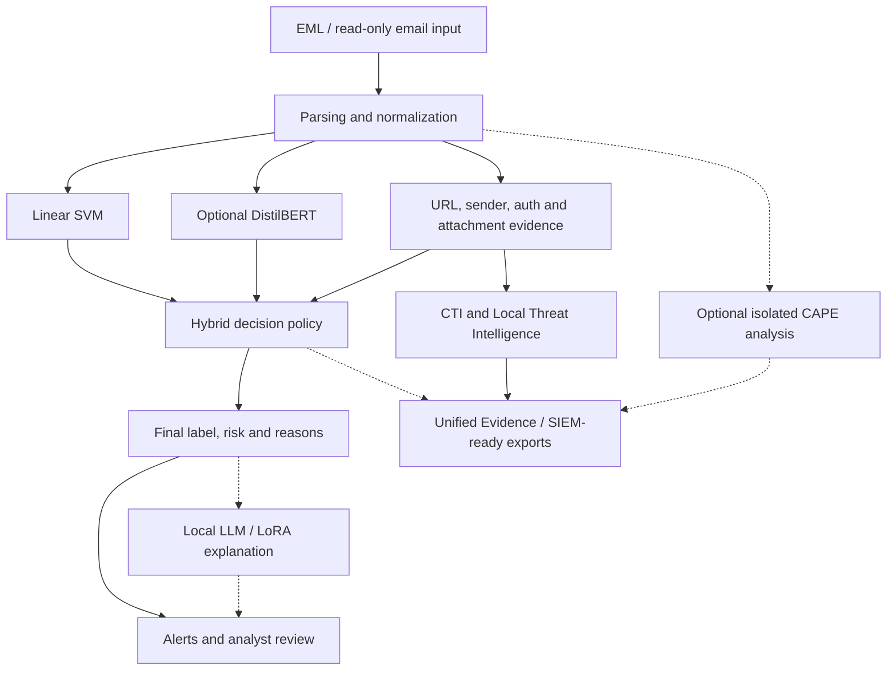

# System Architecture

## Overview

The prototype combines text-based predictions with observable email-security evidence.

Its design separates detection, enrichment, explanation and mailbox operations.

## Main processing flow

The dashed paths represent supporting or optional processes, not alternative final-decision authorities.

## Classification layer

The text-analysis layer uses a Linear SVM classifier and, where applicable, an additional DistilBERT signal.

These predictions provide information to the hybrid decision policy.

The system does not treat either model's prediction as sufficient evidence for all phishing scenarios.

## Structured email evidence

Additional analyzers examine:

- Sender and domain relationships.
- Displayed URLs versus actual HTML link destinations.
- Suspicious or lookalike domain structures.
- Available SPF/DKIM/DMARC-related Authentication-Results.
- Attachment names, types and relevant metadata.
- Available trusted-service and threat-intelligence context.

Authentication-Results parsing must not be confused with independent cryptographic DKIM verification.

## Hybrid decision policy

The hybrid layer combines model predictions and structured indicators to determine the final risk and triage outcome.

Depending on available evidence, suspicious messages may be referred for manual review.

The policy is alert-oriented and does not automatically delete, block or quarantine email.

## Threat intelligence and evidence

CTI and Local Threat Intelligence can associate observed indicators with additional context.

SIEM-ready outputs and IOC exports support downstream investigation. Simulated blocklist artifacts are not evidence of real network enforcement.

Unified Evidence organizes information from available analysis components while preserving the hybrid policy's decision authority.

## CAPE integration

On-demand CAPE analysis is designed for an isolated laboratory environment.

Its role is to provide additional technical evidence when an authorized sandbox task is performed.

CAPE output does not automatically replace the original classification.

## LLM and LoRA assistance

Local LLM/LoRA components provide analyst-oriented explanations and secondary assessments.

Disagreement with a high-risk hybrid verdict is a matter for review, not an automatic authorization to allow the message.

## Application environment

The research implementation uses a FastAPI backend and a custom frontend.

The local environment and operational integrations are outside the public release scope.
